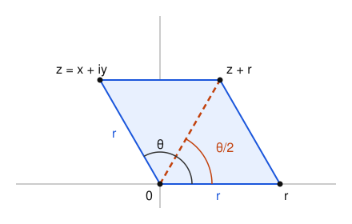

# atan2 identities revisited

The identities for the two-argument arctangent from 2015, rebuilt on one idea:
$\mathrm{atan2}(y, x)$ is the angle of the complex number $x + iy$, and angles
add when complex numbers multiply.

*Xin-Xin*

This revisits [atan2 identities](../2015-03-13%201%20atan2%20identities/README.md)
and [Halving the arctangent split](../2015-03-14%202%20Halving%20the%20arctangent%20split/README.md),
which are typed up from the original handwritten notes. Those docs list the
identities and check them case by case. This one proves them from a single
rule, generalizes the split of atan2 into two arctangents, and adds a way to
compute atan2 accurately. The main results are proved in Lean, and
[`check_identities.py`](check_identities.py) checks every identity
numerically.

## Setup

Throughout, $z = x + iy$ is a nonzero complex number with $x$ and $y$ real,
$r = \sqrt{x^2 + y^2}$ is its distance from 0, and $\theta = \mathrm{atan2}(y, x)$
is its angle, chosen in $(-\pi, \pi]$. So

$$
z = r(\cos\theta + i\sin\theta), \qquad
\cos\theta = \frac{x}{r}, \qquad \sin\theta = \frac{y}{r}.
$$

$\mathrm{atan}$ is the ordinary arctangent, with values in
$(-\tfrac{\pi}{2}, \tfrac{\pi}{2})$, and $\mathrm{atan}(t)$ is the angle of
$1 + it$.

**The cut.** atan2 jumps from $\pi$ to just above $-\pi$ as a point crosses
the negative x-axis. Most conditions in the old docs, such as $y \ne 0$ or
$x > 0$, say that $z$ is off the closed negative x-axis: $z$ isn't a real
number $\le 0$. This doc says that directly. An equivalent test is
$x + r > 0$, since $x + r = 0$ exactly when $y = 0$ and $x \le 0$.

**Basic facts.** These follow straight from the definition.

| Identity | Holds when |
|---|---|
| $\mathrm{atan2}(ay, ax) = \mathrm{atan2}(y, x)$ | $a > 0$ |
| $\mathrm{atan2}(-y, x) = -\mathrm{atan2}(y, x)$ | $z$ off the cut |
| $\mathrm{atan2}(y, x) = \mathrm{atan}(y/x)$ | $x > 0$ |
| $\mathrm{atan2}(y, x) = \mathrm{atan}(y/x) \pm \pi$, with the sign of $y$ | $x < 0$, $y \ne 0$ |

On the cut the negation rule fails: for $x < 0$, $\mathrm{atan2}(0, x) = \pi$,
and $-\pi$ isn't an allowed angle.

## The product rule

**Product rule.** For nonzero $z$ and $w$,

$$
\mathrm{atan2}(zw) = \mathrm{atan2}(z) + \mathrm{atan2}(w)
\quad \text{whenever the right side lies in } (-\pi, \pi].
$$

Here $\mathrm{atan2}(z)$ is short for the angle of $z$. Otherwise the two sides
differ by $2\pi$.

**Proof.** Write $z = |z|e^{i\alpha}$ and $w = |w|e^{i\beta}$. Then
$zw = |zw|e^{i(\alpha + \beta)}$, so $\alpha + \beta$ is an angle of $zw$.
Angles of the same number differ by multiples of $2\pi$, and only one of them
lies in $(-\pi, \pi]$. $\square$

Almost every identity in the 2015 notes is this rule applied to a product
whose angles are known to be small.

## Sums of arctangents

Each $\mathrm{atan}(t)$ lies strictly between $-\tfrac{\pi}{2}$ and
$\tfrac{\pi}{2}$, so a sum of two of them lies strictly between $-\pi$ and
$\pi$, and the product rule always applies. Since

$$
(1 + ix)(1 + iy) = (1 - xy) + i(x + y),
$$

it gives, for all real $x$ and $y$:

$$
\boxed{\mathrm{atan}(x) + \mathrm{atan}(y) = \mathrm{atan2}(x + y, 1 - xy)}
$$

The other sums in the notes come out the same way.

**Doubling.** Take $y = x$: $(1 + ix)^2 = (1 - x^2) + 2ix$, so

$$
2 \mathrm{atan}(x) = \mathrm{atan2}(2x, 1 - x^2).
$$

**Quotients.** For $b_1, b_2 > 0$, $\mathrm{atan}(a_k/b_k)$ is the angle of
$b_k + ia_k$, and $(b_1 + ia_1)(b_2 + ia_2) = (b_1 b_2 - a_1 a_2) + i(a_1 b_2 + a_2 b_1)$:

$$
\mathrm{atan}\frac{a_1}{b_1} + \mathrm{atan}\frac{a_2}{b_2} =
\mathrm{atan2}(a_1 b_2 + a_2 b_1, b_1 b_2 - a_1 a_2).
$$

If $b_1$ or $b_2$ is negative, multiply both arguments on the right by the sign
of $b_1 b_2$. That's the $\mathrm{sgn}(b_1 b_2)$ in the old doc.

**Equal first arguments.** For $x \ne 0$, both
$\mathrm{atan2}(x, 1 - y)$ and $\mathrm{atan2}(x, 1 + y)$ lie on the same side
of 0, strictly between $-\pi$ and $\pi$. Their sum is the angle of
$(1 - y + ix)(1 + y + ix) = (1 - x^2 - y^2) + 2ix$, which has the sign of $x$,
so

$$
\mathrm{atan2}(x, 1 - y) + \mathrm{atan2}(x, 1 + y) = \mathrm{atan2}(2x, 1 - x^2 - y^2).
$$

**Complex arctangents.** The complex arctangent satisfies
$\mathrm{atan}(w) = \frac{1}{2i}\log\frac{1 + iw}{1 - iw}$. For
$w = a + bi$ and its conjugate, away from the branch cuts of $\log$, the sum is
the angle of $(1 - b + ia)(1 + b + ia)$, so the last identity gives

$$
\mathrm{atan}(a + bi) + \mathrm{atan}(a - bi) = \mathrm{atan2}(2a, 1 - a^2 - b^2),
\qquad a \ne 0.
$$

The next sections don't need it: they keep everything real.

## The half-angle form

For $z$ off the cut:

$$
\boxed{\mathrm{atan2}(y, x) = 2 \mathrm{atan}\frac{y}{x + r}}
\qquad \text{and, if } y \ne 0, \qquad
\mathrm{atan2}(y, x) = 2 \mathrm{atan}\frac{r - x}{y}.
$$

The two fractions are equal, because $(r + x)(r - x) = r^2 - x^2 = y^2$.

**Proof.** The half-angle formula for tangent gives

$$
\tan\frac{\theta}{2} = \frac{\sin\theta}{1 + \cos\theta} = \frac{y/r}{1 + x/r} = \frac{y}{r + x}.
$$

Off the cut, $\theta$ lies strictly between $-\pi$ and $\pi$, so
$\frac{\theta}{2}$ lies strictly between $-\tfrac{\pi}{2}$ and $\tfrac{\pi}{2}$,
where $\mathrm{atan}$ undoes $\tan$. $\square$

**The picture.** $z$ and the real number $r$ have the same length, so $0$,
$z$, $z + r$ and $r$ are the corners of a rhombus. The diagonal from $0$ to
$z + r$ bisects the angle $\theta$, so the angle of $z + r$ is
$\frac{\theta}{2}$, and its real part $x + r$ is positive.



In complex numbers, the rhombus says $(z + r)^2 = 2(x + r)z$, which the Lean
proof uses. That also gives the halving rule

$$
\frac{1}{2} \mathrm{atan2}(y, x) = \mathrm{atan2}(y, x + r),
$$

valid everywhere off the cut.

**Doubling.** In the other direction, $z^2 = (x^2 - y^2) + 2ixy$, so by the
product rule

$$
2 \mathrm{atan2}(y, x) = \mathrm{atan2}(2xy, x^2 - y^2)
\qquad \text{when } -\tfrac{\pi}{2} < \theta \le \tfrac{\pi}{2},
$$

that is, when $x > 0$, or $x = 0$ and $y > 0$. Otherwise the two sides differ
by $2\pi$. The halving identity in the old doc,
$\frac{1}{2} \mathrm{atan2}(y, \frac{x^2 - y^2}{2x}) = \mathrm{atan2}(y, x)$
for $x > 0$, is this one with both arguments divided by $2x$.

## Splitting atan2 into two arctangents

The 2015 notes write $\mathrm{atan2}(b, a)$ as $\mathrm{atan}(x) + \mathrm{atan}(y)$
by solving $x + y = b$ and $1 - xy = a$. That needs
$b^2 + 4a - 4 \ge 0$ for real $x$ and $y$, and the notes reach for complex
arctangents otherwise. There's a whole family of splits, and some member of it
is always real.

**Splitting rule.** Let $(b, a)$ be off the cut and let $c > 0$. If $x$ and
$y$ are the roots of

$$
t^2 - cbt + (1 - ca) = 0,
$$

which by the quadratic formula are

$$
x = \frac{cb + \sqrt{c^2 b^2 + 4ca - 4}}{2}, \qquad
y = \frac{cb - \sqrt{c^2 b^2 + 4ca - 4}}{2},
$$

then

$$
\mathrm{atan}(x) + \mathrm{atan}(y) = \mathrm{atan2}(b, a).
$$

The next paragraph shows which $c$ make the square root real. With $c = 1$
these are the roots from the 2015 notes.

**Vieta's formulas.** If $x$ and $y$ are the roots of $t^2 - pt + q = 0$,
then the polynomial factors as $(t - x)(t - y) = t^2 - (x + y)t + xy$.
Matching coefficients gives

$$
x + y = p, \qquad xy = q.
$$

That is, the sum of the roots is minus the coefficient of $t$ and their
product is the constant term. You can also check it from the formulas above:
adding them cancels the square roots and gives $cb$, and multiplying them
gives $\frac{c^2 b^2 - (c^2 b^2 + 4ca - 4)}{4} = 1 - ca$.

**Proof.** By Vieta's formulas with $p = cb$ and $q = 1 - ca$, $x + y = cb$ and
$xy = 1 - ca$, so

$$
(1 + ix)(1 + iy) = (1 - xy) + i(x + y) = ca + icb = c(a + ib).
$$

The sum of arctangents is the angle of the left side, and multiplying by
$c > 0$ doesn't change angles. $\square$

**Which c give real roots.** The discriminant is $c^2 b^2 + 4ca - 4$. For
$b \ne 0$ it's an upward parabola in $c$ with one positive root,

$$
c_0 = \frac{2(r - a)}{b^2} = \frac{2}{r + a},
\qquad r = \sqrt{a^2 + b^2},
$$

so the roots are real exactly when $c \ge c_0$. For $b = 0$ and $a > 0$, the
condition is $c \ge \frac{1}{a}$, which is the same formula. The 2015 split is
$c = 1$, which is why it only works when $b^2 + 4a - 4 \ge 0$, that is, when
$c_0 \le 1$.

**The smallest c gives the half-angle form.** At $c = c_0$ the roots
coincide: $x = y = \frac{c_0 b}{2} = \frac{b}{r + a}$. The split becomes

$$
\mathrm{atan2}(b, a) = 2 \mathrm{atan}\frac{b}{a + r},
$$

the half-angle form. So the half-angle form is the edge of the family, where
the two arctangents are equal.

**Examples.** For $\mathrm{atan2}(1, 0) = \frac{\pi}{2}$, $r = 1$ and
$c_0 = 2$.

- $c = 1$ gives $t^2 - t + 1 = 0$, with complex roots.
- $c = 2$ gives $(t - 1)^2 = 0$, so $\mathrm{atan}(1) + \mathrm{atan}(1) = \frac{\pi}{2}$.
- $c = 3$ gives $t^2 - 3t + 1 = 0$, with roots $\varphi^2$ and $\varphi^{-2}$,
  where $\varphi$ is the golden ratio. So $\mathrm{atan}(\varphi^2) + \mathrm{atan}(\varphi^{-2}) = \frac{\pi}{2}$.

**Why the second 2015 doc collapsed.** That doc halves each of the two
arctangents in the $c = 1$ split and adds them. Halving
$\mathrm{atan}(x) + \mathrm{atan}(y)$ term by term gives half of
$\mathrm{atan2}(b, a)$. Half of an angle off the cut is given by the halving
rule above, so a page of algebra had to end at
$\mathrm{atan2}(b, a) = 2 \mathrm{atan2}(b, a + r)$.

## Computing atan2 accurately

The half-angle form gives atan2 from one ordinary arctangent, but the two
versions behave differently in floating point.

- For $x \ge 0$, $x + r$ adds two nonnegative numbers, so
  $\frac{y}{x + r}$ is accurate.
- For $x < 0$, $x + r$ subtracts two nearly equal numbers when $z$ is close to
  the negative x-axis, and most of the digits cancel. But there
  $r - x = r + |x|$ is a sum of positive numbers, so $\frac{r - x}{y}$ is
  accurate.

So compute

$$
\mathrm{atan2}(y, x) =
\begin{cases}
2 \mathrm{atan}\dfrac{y}{r + x}, & x \ge 0 \\
2 \mathrm{atan}\dfrac{r - x}{y}, & x < 0, y \ne 0 \\
\pi, & x < 0, y = 0
\end{cases}
$$

with $r$ computed by a `hypot` function, which avoids overflow in
$x^2 + y^2$. Each step is then a sum, product or quotient of numbers that are
already accurate, so the relative errors stay small. See
[Rounding and error bounds](../2026-11-02%201%20Rounding%20and%20error%20bounds/README.md)
for how such errors add up.

In double precision with $x = -1$ and $y = 10^{-3}$:

| Method | Result |
|---|---|
| $2 \mathrm{atan}(y/(r + x))$ | 3.14059265392**3009** |
| $2 \mathrm{atan}((r - x)/y)$ | 3.1405926539231266 |
| Library `atan2` | 3.1405926539231266 |

The first loses about 5 of its 17 digits. With $y = 10^{-8}$, $r + x$ rounds
to exactly 0 and the first method gives $\pi$, wrong from the ninth digit on.

## Lean proof

`Atan2.lean` proves the core results using Mathlib, where atan2 is
`Complex.arg`, the angle of a complex number.

> **Status:** not yet checked. Please paste it into
> <https://live.lean-lang.org/#project=mathlib-stable> and confirm there are no
> errors or warnings.

| Theorem | Statement |
|---|---|
| `arg_eq_arctan` | If $x > 0$, then $\mathrm{atan2}(y, x) = \mathrm{atan}(y/x)$ |
| `arg_one_add_mul_I` | $\mathrm{atan}(x)$ is the angle of $1 + ix$ |
| `arctan_add_arctan` | $\mathrm{atan}(x) + \mathrm{atan}(y)$ is the angle of $(1 + ix)(1 + iy)$ |
| `arctan_add_arctan_eq_arg` | The splitting rule: if $c > 0$, $x + y = cb$ and $1 - xy = ca$, then $\mathrm{atan}(x) + \mathrm{atan}(y) = \mathrm{atan2}(b, a)$ |
| `half_angle` | If $x + r > 0$, then $\mathrm{atan2}(y, x) = 2 \mathrm{atan}(y/(x + r))$ |

The product rule itself is Mathlib's `Complex.arg_mul`.

To check it locally, see the [root README](../README.md) for installing Lean.
Then, from this directory:

```bash
lake exe cache get
```

```bash
lake build
```

Next: [Input places for atan and atan2](../2026-11-03%20Input%20places%20for%20atan%20and%20atan2/README.md) works out how many places the inputs need for a given output accuracy.
